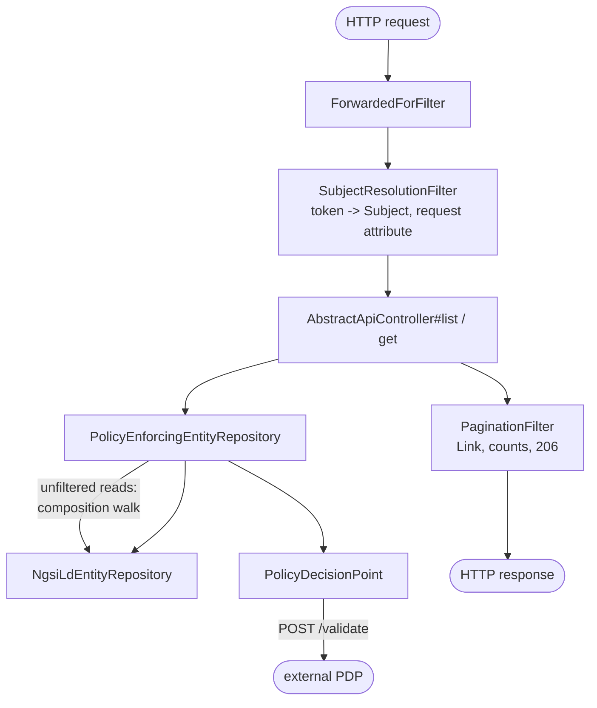

# Architecture: per-entity access policies

> :construction: Proposal. [DECISIONS.md](./DECISIONS.md) records the decisions this rests on and
> the alternatives weighed against them.

- [Goals and non-goals](#goals-and-non-goals)
- [Overview](#overview)
- [Why at the storage port](#why-at-the-storage-port)
- [The decision model](#the-decision-model)
- [Where a provider writes a policy](#where-a-provider-writes-a-policy)
- [Components](#components)
- [Identity: who is calling](#identity-who-is-calling)
- [The PDP contract](#the-pdp-contract)
- [Pagination](#pagination)
- [Writes: ordering and quoting](#writes-ordering-and-quoting)
- [Bypass: the callers that must not be filtered](#bypass-the-callers-that-must-not-be-filtered)
- [Caching](#caching)
- [Defaults and failure modes](#defaults-and-failure-modes)
- [Audit](#audit)
- [Configuration](#configuration)
- [Testing](#testing)
- [Rollout](#rollout)
- [Open questions](#open-questions)

## Goals and non-goals

**Goals**

* A policy carried by a TMForum entity governs every access to that entity, whoever is calling.
* Two separable layers: **visibility** (may the subject see it at all) and **contractability** (may
  the subject order it).
* Constraints may reference the calling subject's verified credential claims — which is what makes
  "participants established in DE, AT or CH" expressible.
* Pagination stays TMF630-correct: `X-Result-Count`, `X-Total-Count`, the `Link` relations and the
  `206` status describe the collection **as the caller sees it**.
* **Optional and inert when off.** With `access-policy.enabled` unset, no bean is created, no
  behaviour changes, and no call leaves the process.
* **No coupling to one policy engine or identity stack.** The project depends on an endpoint
  contract, not on a product.

**Non-goals**

* A policy language or an evaluation engine. Evaluation is delegated.
* Authentication as a product feature. The filter validates a token because it needs a subject; it
  is not a general security layer for these APIs, and the gateway in front keeps doing its job.
* Entitlement to whatever service a product grants. That is enforced elsewhere, after an order
  completes (plane 1 in [ANALYSIS.md](./ANALYSIS.md#plane-1--the-data-plane-policy-authorizationpolicy)).
* Row-level security on arbitrary entity types. The feature targets the catalog, ordering and quote
  resources; see [The decision model](#the-decision-model).

## Overview

A new `access-policy` module, three beans, all `@Requires(property = "access-policy.enabled", value = "true")`:

| Bean | Kind | Job |
|---|---|---|
| `SubjectResolutionFilter` | `@Filter(MATCH_ALL_PATTERN)` `HttpServerFilter` | validate the bearer token, publish a `Subject` as a request attribute |
| `PolicyEnforcingEntityRepository` | `@Primary` decorator of `EntityRepository` | filter what the storage port returns; refill pages; recompute the total |
| `PolicyDecisionPoint` | `@Client`-backed service | ask the external PDP, cache the answer |



Nothing in the ~44 controllers changes for reads. The decorator sits under them, returns a
`PagedResult` that is correct for the caller, and `AbstractApiController#list` and `PaginationFilter`
produce correct headers from it exactly as they do today.

## Why at the storage port

Three seams were candidates: an `HttpServerFilter` over the serialised response, the controllers, or
the storage port.

**The response filter cannot work here.** `PaginationFilter` derives `X-Total-Count`, the `next` and
`last` link relations and the `200`/`206` status from the total that
[`AbstractApiController#list`](../../common/src/main/java/org/fiware/tmforum/common/rest/AbstractApiController.java)
stashed, which comes from the broker and counts the **unfiltered** set. Removing items from the body
afterwards leaves every one of those describing a collection the caller is not allowed to see:
wrong counts, `next` links that page through hidden entities, and `206 Partial Content` asserting a
subset of something invisible. The filter would have to reach back and rewrite state an earlier
stage already computed.

**The controllers are the wrong altitude.** Forty-four list endpoints call
`AbstractApiController#list`, but reads also happen through `get`, through `listPolymorphic`, and
inside `ReferenceValidationService`. Enforcing per controller means enforcing in some of those.

**The storage port is the single seam.** Every read goes through
[`EntityReadRepository`](../../storage-api/src/main/java/org/fiware/tmforum/storage/EntityReadRepository.java).
A decorator there sees `get`, `findEntities` and `findEntitiesPolymorphic`, can refill a page by
asking the delegate for more, and returns a `PagedResult` whose `items` and `totalCount` are both
the caller's view. Everything above it — the request attributes, the headers, the status — then
follows without modification.

It also keeps the feature honest about [C1](./ANALYSIS.md#constraints-that-shape-any-solution): the
decorator is one `@Requires`-gated bean. Off, it does not exist, and `NgsiLdEntityRepository` is
injected directly as it is today.

## The decision model

**Resources.** Which entity types carry governable policies:

| Entity | Module | Governed by |
|---|---|---|
| `ProductOffering` | `product-catalog` | its own `productOfferingTerm` policies, plus those of its `ProductSpecification` and that spec's `ServiceSpecification`s |
| `ProductSpecification`, `ServiceSpecification` | `product-catalog`, `service-catalog` | their own `authorizationPolicy` characteristics |
| `Catalog`, `Category` | `product-catalog` | a policy targeting them by id, plus the derived rules below |
| `ProductOrder`, `Quote`, `Agreement`, `Product` | ordering, quote, agreement, inventory | party scoping, not offering policies — see [Open questions](#open-questions) |

Every other entity type is ungoverned: the decorator short-circuits on type before anything else, so
`party-catalog`, `usage-management` and the rest cost nothing.

**Actions.** `read`, `create`, `update`, `delete`, `order`. The first four map from the HTTP method;
`order` is a `ProductOrder` or `Quote` referencing an offering.

**Scopes.** The evaluation point, passed to the PDP so one policy can carry rules for several:

| Scope | Asked when | Denial means |
|---|---|---|
| `catalog` | reading a governed entity | omitted from the list; a direct `GET /{id}` answers `404` |
| `contract.negotiation` | creating a `ProductOrder` or `Quote` | `403`, naming the offering |

These are the scope names the Dataspace Protocol side already uses, deliberately: a policy written
once is evaluated the same way on both paths ([C6](./ANALYSIS.md#constraints-that-shape-any-solution)).
The PDP additionally receives `protocol: "tmf"`, so a policy that genuinely needs to differentiate
can, while one that does not — almost all of them — does not have to.

**Derived visibility**, so a provider does not restate a policy on every related entity:

* **Downward:** an offering is visible only if its `Catalog` and `Category` are. A restricted catalog
  hides its contents with no policy on the contents.
* **Upward:** a `Catalog` or `Category` with no policy of its own is visible if at least one of its
  offerings is visible to the subject. Off by default — it costs an extra query per candidate.

## Where a provider writes a policy

**1 — on the offering**, in `productOfferingTerm`. This already exists and is already honoured by
the Dataspace Protocol side. The term needs a `@schemaLocation` that admits both keys, or the API
rejects it with `400` ([AP-01 finding](./AP-01_FINDINGS.md#what-a-provider-must-write)):

```json
"productOfferingTerm": [ { "name": "edc:contractDefinition",
  "@schemaLocation": "https://raw.githubusercontent.com/wistefan/edc-dsc/refs/heads/init/schemas/contract-definition.json",
  "accessPolicy":   { … },
  "contractPolicy": { … } } ]
```

**2 — on a specification**, as an `authorizationPolicy` characteristic whose permission declares
`dspace:scope: "catalog"`. The scope is the discriminator: a permission *without* one keeps its
existing meaning elsewhere in the ecosystem (a data-plane policy applied after an order completes)
and is ignored here. That is what makes the feature additive rather than a migration.

**3 — on a catalog or category.** TMF620 gives neither a characteristic array. Rather than extend
the schema, the decorator also matches policies registered at the PDP whose `odrl:target` names the
entity by id. See [POLICY_EXAMPLES.md](./POLICY_EXAMPLES.md#a-catalog-restricted-to-a-named-partner).

**4 — a deployment default**, for entities no policy resolves for. See
[Defaults](#defaults-and-failure-modes).

Policies **union, never override**: the effective policy set of an offering is the union over the
offering, its specification and that specification's services, keyed by `odrl:uid`. Two different
policies claiming one uid is an error, not a silent pick.

## Components

### `access-policy` module

A new Maven module beside `storage-api`, depended on by `common`. It must not depend on `common`
(the dependency runs the other way) and must not know about any module's domain classes — it works
against an interface the governed types implement, or against a small SPI that maps a domain object
to "the policies it carries". Keeping it that way is what prevents the feature leaking into the 21
API modules.

```
access-policy/src/main/java/org/fiware/tmforum/accesspolicy/
  AccessPolicyProperties.java          @ConfigurationProperties("access-policy")
  Subject.java                         record Subject(String identity, List<Map<String,Object>> credentials, …)
  SubjectResolutionFilter.java         @Filter(MATCH_ALL_PATTERN), HttpServerFilter, Ordered
  PolicyCarrier.java                   SPI: the policies an entity carries, and at which scope
  PolicyResolver.java                  composition walk + derived visibility, over the *delegate* port
  PolicyDecisionPoint.java             @Client-backed, reactive, @Cacheable
  ValidationRequest.java               the PDP wire model
  AccessDecision.java                  record AccessDecision(boolean permitted, String reason, String policyUid)
  PolicyEnforcingEntityRepository.java @Primary decorator of EntityRepository
  AccessAuditPublisher.java            one record per decision, best-effort
```

### `PolicyEnforcingEntityRepository`

```java
@Primary
@Singleton
@Requires(property = "access-policy.enabled", value = "true")
public class PolicyEnforcingEntityRepository implements EntityRepository {

    private final NgsiLdEntityRepository delegate;   // concrete type: never inject EntityRepository here
    …
}
```

The delegate is injected by concrete type. Injecting the interface would bind the decorator to
itself, and — more subtly — the **composition walk must use the delegate directly**: resolving the
`ProductSpecification` behind an offering is an internal read, and routing it through the decorator
would make the filter censor its own inputs and hide an offering because its specification is
restricted from the caller.

Writes pass straight through. The port's write side is untouched; ordering is handled separately
([Writes](#writes-ordering-and-quoting)).

### `SubjectResolutionFilter`

Modelled on [`ForwardedForFilter`](../../common/src/main/java/org/fiware/tmforum/common/filter/ForwardedForFilter.java):
an `HttpServerFilter` that computes per-request information and publishes it as a request attribute
for later stages. It must run before anything that reads the subject, and
`ServerRequestContext.currentRequest()` is how the decorator reaches it — the same mechanism
`AbstractApiController` and `FieldCleaningSerializer` already rely on, so no new propagation
machinery is introduced.

## Identity: who is calling

This project validates no tokens today. The filter has to bring that capability with it, and it
cannot be delegated to the gateway, because the callers that most need enforcing never pass through
one ([C3](./ANALYSIS.md#constraints-that-shape-any-solution)).

**Validation.** Signature, issuer, audience and expiry against a configured JWKS endpoint, with the
key set cached and refreshed. Whether that is `micronaut-security` or a direct `nimbus-jose-jwt`
dependency is an [open question](#open-questions): the former is idiomatic and large, the latter is
small and means hand-writing the validation.

**Claims.** The subject's identity is a configured claim (default: the credential issuer). Where the
deployment's verifier embeds the whole verified credential in the token — which the DSC reference
deployment does — every claim a policy might constrain on is present with no further lookup.

**Callers must forward the user's token.** A caller acting on a user's behalf that sends none is
anonymous to this filter. That is a real prerequisite on the ecosystem, not a detail:

| Caller | Today | Needed |
|---|---|---|
| API consumer through a gateway | forwards its own token | nothing |
| **Marketplace UI backend** | holds the user's session, sends no token onward | **must forward the user's access token** — an upstream change in that component |
| contract-management, EDC connector, consent-facade | no token | a bypass, see below |

Until a UI backend forwards the token, its calls are anonymous and `observe` mode plus the audit log
is the honest answer — the gap is measured rather than pretended away.

## The PDP contract

A single reactive call, modelled on the request the Dataspace Protocol side already sends so that
one policy means one thing:

```
POST {access-policy.pdp.url}/validate
{
  "policy":    { "…the policy the entity carries, expanded JSON-LD…" },
  "jsonInput": {
    "payload": { "scope": "catalog", "protocol": "tmf", "action": "read",
                 "resource": { "type": "ProductOffering", "id": "urn:ngsi-ld:ProductOffering:42",
                               "catalog": "urn:…", "relatedParty": [ … ] } },
    "subject": { "identity": "did:web:consumer.example",
                 "claims": { "vc": [ { "…" } ] } }
  }
}
→ 200 { "permitted": true | false, "reason": "…" }
```

The project depends on this shape, not on the implementation behind it. The reference PDP is the
[ODRL-PAP](https://github.com/SEAMWARE/odrl-pap); any service answering the same contract works.

**Deduplication is what makes this affordable.** A catalog of N offerings typically carries K
distinct policy uids with K far below N — a provider writes a handful of policies and reuses them.
For a policy constraining only on the subject, the answer depends on `(policy uid, subject)` alone,
so the decorator issues at most one `/validate` per distinct uid per subject, cached across
requests. A policy that *does* constrain on resource facts opts out of the sharing, which the
decorator detects from the policy's own target refinements.

## Pagination

The hard part, and the reason for the storage-port seam.

`findEntities(offset, limit, …)` returns a materialised `PagedResult`, not a cursor, and
`PagedResult.totalCount` is the broker's count of the **unfiltered** match set — only populated when
`general.countHeader` is configured for the active broker profile and the broker sent it.

**Page filling.** The client's `offset` and `limit` index the *permitted* subsequence. The decorator
fetches a window from the delegate, decides each entity, and repeats with an advancing storage
offset until it has skipped `offset` permitted entities and collected `limit` of them, or the
delegate returns a short page (the match set is exhausted). It then returns
`new PagedResult<>(items, offset, limit, total)` with the client's own offset and limit — so
`AbstractApiController#list` sets the request attributes, and `PaginationFilter` builds `Link` and
`X-Result-Count`, exactly as today.

Cost control, in the order it should be built:

1. **Window size.** Fetch `limit × overfetchFactor` per delegate call rather than `limit`, so a
   sparsely-permitted collection costs round trips proportional to the hidden fraction, not to the
   number of items.
2. **Cursor memo.** Cache, per `(subject, query fingerprint)`, the storage offset at which each
   filtered offset begins, populated as a client pages forward. Sequential paging — what every UI
   does — then costs one window per page instead of rescanning from zero. A deep random `offset`
   without a memo entry is the expensive case, and `maxScan` bounds it.
3. **Predicate push-down.** When every governing policy for a type reduces to an attribute predicate
   (`relatedParty`, `category`, `lifecycleStatus`), translate it into the NGSI-LD query instead of
   deciding per entity, and let the broker do offset, limit and count. `QueryParser` / `QueryParams`
   already build that syntax. This is exact and O(1) and is the proper endgame for large catalogs;
   it is a later phase because it only covers policies of a particular shape.

**`X-Total-Count`.** An exact total means deciding the whole match set, not one page:

| `access-policy.total-count` | Behaviour |
|---|---|
| `exact` (default) | scan and decide the match set, bounded by `max-scan`; `PagedResult.totalCount` becomes the permitted count, so `X-Total-Count`, `last` and the `206` status are all correct. Above the bound, degrade to `omit` |
| `omit` | pass `null` as the total. `PaginationFilter` then omits `X-Total-Count` and `last`, keeps the status at `200`, and infers `next` from `returnedCount == limit` — which stays correct precisely because pages are refilled |
| `upstream` | pass the broker's unfiltered total through. **Leaks the size of the hidden set** and produces links into it; offered only for a client that cannot cope without a total |

`exact` is defensible because of deduplication: scanning 10 000 offerings sharing six policies costs
six PDP calls and 10 000 cached in-memory evaluations, not 10 000 round trips. When the broker
reports no total at all, there is nothing to correct and the result stays `null` as it does today.

## Writes: ordering and quoting

The read path needs no controller change. The write path does, and that asymmetry is worth stating.

`POST /productOrder` and `POST /quote` reference an offering by id. The check belongs where the
reference is already resolved — the create path of `product-ordering-management` and `quote`, which
runs referential integrity through `ReferenceValidationService`. The module loads the referenced
offering (through the **delegate**, so an invisible offering still resolves), evaluates its contract
policy at `contract.negotiation`, and fails the create with `403` before anything is written. No
order in an intermediate state is left behind.

Two modules change, and only those two.

## Bypass: the callers that must not be filtered

`contract-management`, the EDC connector and `consent-facade` must read unfiltered, and none of them
sends a token today ([C2](./ANALYSIS.md#constraints-that-shape-any-solution)).

**`bypass-unauthenticated: true` (initial default).** A request carrying no bearer token is not
filtered. This reproduces today's behaviour for every infrastructure caller with no change in any of
them, which is what makes the feature deployable at all.

It is also a hole whenever the API is reachable without a token. So, whenever the feature is
enabled, the deployment must ensure the API is not published unauthenticated, and must restrict
which workloads can reach it directly. That is a deployment obligation this project can only
document — see the DSC's provider deployment guidance — and it is the reason the setting is named
for what it does rather than something reassuring.

**`bypass-roles` / `bypass-subjects` (the target state).** Infrastructure callers carry their own
token with a configured role, or an identity on an allowlist, and are exempt *by identity* rather
than by its absence. `bypass-unauthenticated` then goes to `false` and an anonymous request is
decided by `anonymous-decision` like any other subject.

The migration is: enable with the bypass on → give infrastructure callers tokens → turn it off. Each
step is independently verifiable.

**Owner exemption.** A subject whose identity matches a `relatedParty` with role `provider` is never
filtered from its own entities. Without it, a provider is locked out of the offering whose policy
locks them out, including out of fixing the policy.

## Caching

| Cache | Key | Invalidation |
|---|---|---|
| decision | policy uid + subject identity + credential fingerprint (+ resource facts, only for resource-constrained policies) | `min(token exp, decision-ttl)` |
| composition walk | specification id | TTL; an entity write passes through the same process, so a direct eviction is available |
| cursor memo | subject + query fingerprint | short TTL, size-bounded |
| JWKS | issuer | standard refresh |

Micronaut `@Cacheable` over the already-wired in-memory or Redis backend. The credential fingerprint
in the decision key matters: a subject presenting a different credential set is a different subject
for policy purposes, and keying on identity alone would let a weak presentation inherit a strong
one's decision.

## Defaults and failure modes

| Setting | Default | Why |
|---|---|---|
| `enabled` | `false` | the feature is opt-in and its beans do not exist when off |
| `default-decision` | `allow` | an entity no policy governs behaves as it does today; a deployment with no policies makes zero PDP calls |
| `bypass-unauthenticated` | `true` | infrastructure callers keep working unchanged; see the obligation above |
| `anonymous-decision` | `allow` | moot while the bypass is on; the real knob once callers carry tokens |
| `fail-open` | `false` | an unreachable PDP denies. For a list that means an empty page, not an unfiltered one |
| `mode` | `enforce` | `observe` decides and audits but filters nothing — how to measure a policy's impact before it bites |
| `owner-exempt` | `true` | see above |
| `derive-catalog-visibility` | `false` | the upward rule costs an extra query |
| `total-count` | `exact` | correct headers by default; degrades to `omit` past `max-scan` |

A denied read answers **`404`**, never `403`: the existence of a restricted entity is itself
information ([C7](./ANALYSIS.md#constraints-that-shape-any-solution)). A denied **order** answers
`403` — by then the caller has demonstrably seen the offering, so there is nothing left to conceal
and a `404` would be misleading.

A fail-closed denial must be distinguishable in the audit record from a policy denial. An operator
hunting for the policy that hid an entity, when the real cause was an unreachable PDP, is a bad
afternoon.

## Audit

One record per decision, emitted best-effort and never changing the decision or blocking the
response: decision, reason, policy uid, resource type and id, subject identity, method, path,
request id. In `observe` mode the audit record is the entire output of the feature.

The deployment target is an OTLP log sink; Micrometer and the OTEL agent are already part of how
this project is run, so the exporter is not new ground.

## Configuration

`@ConfigurationProperties("access-policy")`, in the style of
[`GeneralProperties`](../../common/src/main/java/org/fiware/tmforum/common/configuration/GeneralProperties.java):

```yaml
access-policy:
  # the whole feature; with this unset no bean below exists
  enabled: false
  mode: enforce                 # enforce | observe
  default-decision: allow       # allow | deny
  anonymous-decision: allow
  bypass-unauthenticated: true
  bypass-roles: []
  bypass-subjects: []
  owner-exempt: true
  derive-catalog-visibility: false
  total-count: exact            # exact | omit | upstream
  max-scan: 10000
  overfetch-factor: 4
  decision-ttl: 60s             # a unit is mandatory, a unit-less value is silently dropped
  fail-open: false
  pdp:
    url: http://odrl-pap:8080
    path: /validate
    timeout: 2s
  jwt:
    jwks-uri: http://verifier:3000/.well-known/jwks
    issuer: https://verifier.example.org
    audience:
    identity-claim: verifiableCredential.issuer
  audit:
    enabled: false
```

Governed types are intentionally not configurable: which entity carries which policy is a property
of the TMForum model, not of a deployment.

## Testing

Following the project's conventions ([AGENTS.md](../../AGENTS.md)):

* **Unit tests** (`*Test.java`, JUnit 5 + Mockito) for `PolicyResolver` (composition, uid collisions,
  depth limits, derived visibility) and for the page-refill arithmetic, which is where the bugs will
  be. Parameterized where the cases differ only in data — most of them do.
* **Contract tests** for the decorator against the existing
  `AbstractEntityRepositoryContractTest` fixtures, asserting that with the feature off it is
  transparent and with it on it still satisfies every rule the port's contract states — in
  particular "always emits a page".
* **Integration tests** (`*IT.java` extending `AbstractApiIT`) per use case in
  [USE_CASES.md](./USE_CASES.md), with a stub PDP. [UC-12](./USE_CASES.md#uc-12--paging-a-filtered-collection)
  is the one that must not be skipped: it is the property the whole design exists to preserve, and
  it asserts the `Link` relations and the `206`/`200` status, not only the body.
* Both broker profiles, since `totalCount` availability differs between them.

## Rollout

| Phase | Content |
|---|---|
| 0 | the PDP learns the instance-level vocabulary and the two scopes (external, see [POLICY_EXAMPLES.md](./POLICY_EXAMPLES.md#vocabulary)) |
| 1 | `access-policy` module: properties, `Subject`, `SubjectResolutionFilter`, PDP client. No enforcement; the subject is merely resolvable |
| 2 | decorator: `get` only. `404` on deny, owner exemption, bypass. [UC-1](./USE_CASES.md#uc-1--an-entity-restricted-by-a-subject-attribute) partially, [UC-7](./USE_CASES.md#uc-7--a-provider-manages-its-own-restricted-entity), [UC-8](./USE_CASES.md#uc-8--an-entity-without-a-policy-stays-public) |
| 3 | decorator: `findEntities` / `findEntitiesPolymorphic` with refill and `total-count`. [UC-3](./USE_CASES.md#uc-3--a-private-catalog-for-a-named-partner), [UC-6](./USE_CASES.md#uc-6--a-restriction-inherited-from-a-shared-service-specification), [UC-12](./USE_CASES.md#uc-12--paging-a-filtered-collection) |
| 4 | ordering and quote: contract-policy check on create. [UC-2](./USE_CASES.md#uc-2--visible-but-not-orderable) |
| 5 | audit, `observe` mode, cursor memo |
| 6 | predicate push-down; bypass by identity instead of by absence of one |

## Open questions

1. **JWT validation dependency.** `micronaut-security` is idiomatic and brings a lot; `nimbus-jose-jwt`
   is small and means writing the validation by hand. The second looks right for a feature that must
   be inert when off, but it is a real decision with maintenance consequences.
2. **How does an entity declare the policies it carries?** The `PolicyCarrier` SPI keeps the
   `access-policy` module free of domain classes, but someone has to implement it for
   `ProductOffering`, the two specification types and the catalog types — and that implementation
   has to live somewhere that can see both. Probably `product-shared-models`; it needs checking that
   this does not drag the module graph the wrong way.
3. **Catalog and category policies** have no carrier in TMF620. Matching a PDP-registered policy by
   target id avoids a schema change; whether that is enough is what
   [UC-3](./USE_CASES.md#uc-3--a-private-catalog-for-a-named-partner) tests.
4. **Orders, quotes, agreements and inventory** are listed as "party scoping, not offering policies".
   That rule — a consumer sees their own orders, a provider sees orders against their offerings —
   needs stating precisely enough to implement, and it is not obvious it belongs in this feature.
5. **`total-count: exact` under resource-constrained policies.** Deduplication weakens when a policy
   constrains on the entity id or category, because decisions stop being shareable. `max-scan` bounds
   the damage; whether such policies should instead force `omit` needs a benchmark.
6. **Sorting.** `orderBy` is applied by the broker over the unfiltered set. Filtering afterwards
   preserves relative order, so a sorted filtered page is still correctly sorted — but this should be
   asserted in a test rather than assumed.
